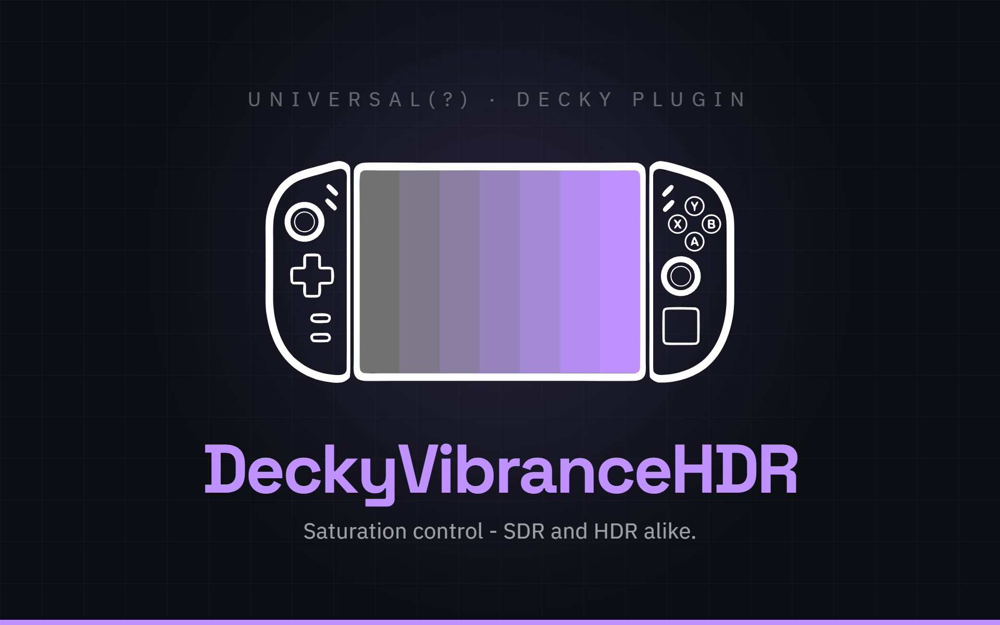

<div align="center">



[](https://github.com/Rayekkk/DeckyVibranceHDR/releases/latest)
[](https://github.com/Rayekkk/DeckyVibranceHDR/releases)
[](#requirements)
[](https://decky.xyz)
[](LICENSE)

**Adjust SDR and HDR saturation from the Steam overlay.**
Use separate controls for the Steam interface and ordinary games, and for games already running in HDR.

[Features](#features) · [Requirements](#requirements) · [Installation](#installation) · [Quick start](#usage) · [Technical details](#how-it-works) · [Troubleshooting](#troubleshooting)

</div>

---

## Features

Decky Vibrance HDR changes colour saturation on the built-in screen through
[gamescope](https://github.com/ValveSoftware/gamescope). SDR and HDR have separate
saved choices. Enabled settings continue working while the Quick Access Menu is closed.

| Control | What it does |
|---|---|
| **SDR saturation** | Adjusts the Steam interface and games not running in HDR, from 100–300% |
| **HDR saturation** | Adjusts games running in HDR, from 100–150%; shown when the panel is not known to lack HDR support |
| **Enabled** | Turns each effect on or off independently and releases its display adjustment when switched off |
| **Back to defaults** | Switches both effects off and returns both sliders to 100% |
| **Updates** | Checks for a release and downloads its installable ZIP; keeps progress and results when the menu is reopened |

The menu explains clipping limits and failed changes. Background checks reapply
enabled settings after detected gamescope/session recovery. Adjustments pause while
an external display is active and return when the built-in screen is active again.

## Requirements

| Requirement | Details |
|---|---|
| Environment | SteamOS or a compatible gamescope-based Game Mode, driving the built-in screen |
| Plugin loader | [Decky Loader](https://decky.xyz) 3.0 or newer |
| Display interfaces | gamescope's colour controls and `xprop`; panel metadata determines the SDR mapping and HDR availability |
| Privileges | Runs as the normal user; no root flag is required |

The plugin chooses its display mapping from the panel's EDID rather than the device
name, the same source gamescope uses for most panels (an EDID without colour data is
read as Rec.709, as gamescope does). It takes the EDID gamescope publishes, or,
when a session does not publish one, the built-in eDP/DSI/LVDS panel's EDID from the
kernel. A few devices ship a gamescope display script with its own colour data
(Steam Deck LCD, Zotac Zone, OXP F1 and GPD Win 4 at the time of writing). 100%
is neutral there too, but where the script and the EDID disagree about the
gamut, steps above 100% can be stronger or weaker than on other devices. It does
not enable HDR in a game or apply its built-in-screen settings to an external
monitor.

Version 1.2.0 was checked on these devices:

| Device | Environment and coverage |
|---|---|
| **Legion Go 2** | Ordinary x86-64 SteamOS; wide-gamut SDR, HDR, Decky restart, Desktop Mode and back, sleep/wake, with backend/display readback |
| **Odin 3** | Armada with Decky running through FEX; standard-gamut SDR with its colour table, HDR, native ARM calculation, Decky restart, Desktop Mode and back, sleep/wake |

Earlier project checks also covered **Legion Go S** with a standard-gamut LCD.
Its panel does not advertise HDR, so the HDR section is hidden. It was not retested
in the latest fix audit. See [validation and device limits](#validation-and-device-limits)
for the exact scope of the latest checks.

## Installation

1. Install [Decky Loader](https://decky.xyz) if you do not already have it.
2. Download `DeckyVibranceHDR-<version>.zip` from [Releases](https://github.com/Rayekkk/DeckyVibranceHDR/releases). Choose the attached plugin ZIP.
3. In Game Mode, open **Quick Access Menu → Decky → Settings → General** and turn on
   **Developer mode**. This adds the **Developer** page.
4. Open **Settings → Developer** and choose **Browse** next to **Install Plugin from ZIP File**.
   Decky warns that it has not reviewed third-party plugins; choose **Continue** (the first
   time, after a short countdown), select the archive and confirm Decky's install dialog.
5. Open **Decky Vibrance HDR** in Decky.

Normal use needs no terminal commands. To make your own package, follow
[Development](#development).

See [CHANGELOG.md](CHANGELOG.md) for the changes in each release. The release badge and download links follow published releases.

### Updating

1. Open **Updates → Check for updates**.
2. If a newer release is available, choose **Download v<version>**.
3. Wait for **Downloaded** and note the completed file path.
4. Install that file as in [Installation](#installation): **Decky → Settings → Developer**,
   **Browse** next to **Install Plugin from ZIP File**, **Continue** on Decky's warning,
   then pick the file and confirm (turn on **Developer mode** under **General** first
   if that page is missing). Decky replaces the installed version itself; there is
   no need to uninstall first.
5. Reopen the plugin and check your saved choices.

**Downloading does not install the update.** Settings are stored outside the installed
plugin folder, in `~/homebrew/settings/DeckyVibranceHDR/settings.json`, so they
survive replacing the plugin and even uninstalling it. To remove them too, delete
that folder.

Checks and downloads continue if you leave the panel. Reopening shows the pending
operation, result or error without starting another request. You can also download
and install the release ZIP manually. The updater offers published releases.

## Usage

### Quick start

1. Open **Decky Vibrance HDR** in the Quick Access Menu.
2. Turn on **Enabled** under **SDR saturation** or **HDR saturation**.
3. Start at **100%**, then increase **Saturation** until you like the result.
4. Let the change finish and check **Now**, the **Last applied** status and any error.

The slider shows your latest selection immediately. Applying it can take longer,
especially when a colour table is being built. The menu shows **Preparing the colours...**
while that work is running. Recent edits are grouped so an older selection does not
keep delaying the one you want.

### SDR saturation

SDR affects the Steam interface and games that are not using HDR. **100%** adds no
saturation boost from this plugin (it hands gamescope its own default value);
larger values make colours more saturated.
These percentages are adjustment levels, not a measurement of the panel's gamut.

The current build provides **100–300%**. The useful range depends on the panel:
wide-gamut screens show a clipping warning above **200%**, while standard-gamut
screens using the additional colour table warn above **260%**. Beyond the warning,
saturated colours can lose detail. Use the message beside the slider as your guide.

While the additional colour table is in use, **Last applied** under **Now** shows
the slider value of the last table handed to gamescope.

### HDR saturation

HDR affects only content already running in HDR. The range is **100–150%**, with a
clipping warning above **130%**. It does not turn an SDR game into an HDR game.

Above 100%, the plugin builds a colour lookup table (LUT) for gamescope. **Now** is
your requested value; **Last applied** is the last value successfully handed to
gamescope. They can differ while building or retrying. This status confirms the
handoff, not a physical measurement of the game's image. Build time varies with
the device and workload.

The section is hidden when complete panel information says HDR/PQ is unsupported.
If panel information is unavailable, or only the kernel's copy of the panel's
EDID could be read (a gamescope display script may add HDR on top of it), the
control may remain visible; its presence
alone is not proof that the game or screen is displaying HDR.

### Turning effects off and resetting

Turning **Enabled** off releases that effect and restores its captured display
setting. A newer colour table supplied by another tool is preserved. If SDR was
already enabled at startup and its earlier baseline is unknown, it returns to
gamescope's native-gamut default.

**Back to defaults** switches both effects off and sets both sliders to 100%.
It also cancels older changes that have not yet been sent. Restoration failures
stay visible and are retried while the plugin is running.

### Status and recovery

**Waiting for backend** means a change has not been answered yet; it usually clears
on its own. **Backend unavailable** describes a connection problem; **Plugin not ready** shows
why startup cannot finish. **Could not load settings** keeps controls paused and
preserves the saved file while it cannot be read; a file that reads but is not
valid settings is kept as `settings.json.corrupt-<time>` and the plugin starts
from defaults; **Settings reset** names that file until the plugin next loads. **Settings not saved** means the latest choices could not
be written to disk. **Could not apply the setting** reports SDR/HDR display errors
separately.

Let an operation finish before judging the image. If a request is still waiting
for Decky, reopening the panel keeps that request's place rather than sending a
second copy. While the panel is open it asks the backend again every second, so
a notice clears by itself once the backend answers.

## Troubleshooting

| What you see | What to do |
|---|---|
| Waiting for backend, Backend unavailable or Plugin not ready | Read the reason, allow startup to finish and confirm Game Mode is active. The panel retries by itself every second. If Decky itself no longer responds, restart Decky; that also reloads its other plugins. |
| Could not load settings | The settings file could not be opened. Resolve the reported file-access problem; the plugin retries loading instead of saving defaults over it. |
| Settings reset, or settings back at defaults after an update or crash | The old file was not valid settings. It is kept next to the new one as `settings.json.corrupt-<time>` in `~/homebrew/settings/DeckyVibranceHDR/`. |
| Settings not saved | Check the reported storage/permission error. The current selection may still be active, but it has not been confirmed saved. |
| Could not apply the setting | Read the SDR, SDR look or HDR error. Allow recovery to retry, then check the applied status. |
| SDR steps above 100% are much stronger or weaker than expected | Your device may use a gamescope display script with its own colour data (see Requirements). Please report the device and its panel so the mapping can be checked. |
| Conflict or colours keep changing | Avoid overlapping colour controls such as vibrantDeck. Another tool can overwrite SDR settings or an SDR/HDR colour table; keep one tool controlling the same effect. |
| The HDR section is missing | Check whether the built-in panel advertises HDR/PQ. This is expected on the standard Legion Go S LCD. |
| HDR changes do not affect a game | Confirm the game is actually running in HDR and check Last applied. The plugin does not enable a game's HDR mode. |
| External display → Standing down | Adjustments are paused for the external screen. Return to the built-in display to resume the saved choices. |
| Preparing the colours... or an older Last applied value | Wait for the latest build. If it stays pending, check the error and backend connection; build time is not fixed across devices. |
| An update check or download failed | Read the error and try again, or download the attached plugin ZIP from Releases and install it through Decky. |
| Reloading takes several seconds | Decky 3.2.10 showed a loader shutdown issue during audits on both devices, and Decky 3.3.0 showed it again on the Odin 3 under FEX. The plugin cannot patch that loader issue. See the [Odin 3 / Armada audit](docs/AUDITS.md#device-validation-latest) for the reproduced limitation. |

When reporting a problem, include the plugin version, device, SteamOS/Armada and
Decky versions, the affected control and its exact status/error.

## How it works

<details>
<summary><b>Display interfaces, colour tables and recovery</b></summary>

The plugin reads gamescope's panel metadata and adjusts X11 properties rather than
changing panel firmware. Those properties live on the XWayland servers gamescope
runs inside its own Wayland session in Game Mode, so the switch of SteamOS's
Desktop Mode to Wayland does not affect them; in Desktop Mode the plugin waits
for gamescope.

| Path | Interface | Behaviour |
|---|---|---|
| SDR on a wide-gamut panel | `GAMESCOPE_COLOR_SDR_GAMUT_WIDENESS` | The scalar control carries the 100–300% range |
| SDR on a standard-gamut panel | The same scalar plus `GAMESCOPE_COLOR_LOOK_G22` | The scalar carries 100–200%; a gamma-2.2 colour table carries the rest |
| HDR | `GAMESCOPE_COLOR_LOOK_PQ` | A PQ colour table adjusts HDR content |

Both colour tables keep a **33³ grid**. HDR calculations use PQ-encoded BT.2020
and ICtCp to adjust chroma while preserving intensity and chroma direction before
clipping. SDR uses the corresponding gamma-2.2 path, source-gamut conversion and
panel white-point adaptation. See [vibrance_lut.py](vibrance_lut.py) for the maths.

Recent completed tables and invariant conversion work are cached. Generation runs
outside the control lock; obsolete jobs are cancelled, and files are published
atomically. Panel information is cached and refreshed when its identity changes.
Background monitoring detects session/display recovery and retries failed applies
or restorations while retaining ownership information.

On Armada systems with x86-64 Decky under FEX, executable architecture checks select
native system Python and `xprop` where supported. Ordinary x86-64 SteamOS keeps its
existing path. This changes execution overhead, not LUT resolution or colour maths.

Settings live in Decky's settings directory, outside the installed plugin folder.
Startup validates them before accepting edits; a failed read keeps the file intact,
and unparseable content is set aside rather than deleted.
The frontend keeps one outstanding read and one write at a time, coalesces unsent
slider edits, and sends any switch or reset ahead of older unsent slider changes.

</details>

## Development

<details>
<summary><b>Build, test and package from source</b></summary>

Use Node.js **22** (the CI version), Python **3.10+** for backend tests, and a ZIP
tool: `zip` on Linux/macOS or 7-Zip on Windows. The commands and `npm run
verify:package` call `python`; where only `python3` exists, install the
`python-is-python3` package (a shell alias is not enough for npm scripts).

```bash
git clone https://github.com/Rayekkk/DeckyVibranceHDR
cd DeckyVibranceHDR
npm ci
npm run typecheck
npm test
python -W error -m unittest discover -s tests -v
npm run package
npm run verify:package
npm audit --audit-level=low
```

**Package rebuilds the frontend** and creates `DeckyVibranceHDR-<version>.zip`.
Install that ZIP through Decky. The package includes the bundled `@decky/api`
source, license and source map; React and `@decky/ui` come from the Decky host.
See [NOTICE](NOTICE) for component provenance.

**Code layout.** Only `main.py` imports Decky's modules; the rest can be tested
without the loader.

| File | Role |
|---|---|
| `main.py` | Decky entry point: controls, scheduling, startup, monitoring and recovery |
| `vibrance_state.py` | What the plugin remembers while it runs, and the slider ranges |
| `vibrance_effects.py` | The SDR atom and the looks: applying them and restoring what was there |
| `vibrance_panel.py` | Which panel is driven: gamut, HDR support, the SDR mapping, docking |
| `vibrance_x11.py` | gamescope's X servers and atoms, through `xprop` |
| `vibrance_edid.py` | EDID parsing: red and white points, HDR/PQ support |
| `vibrance_lut.py` | The colour maths and `.cube` text |
| `vibrance_lutfile.py` | Building LUTs (natively under FEX) and writing them atomically |
| `vibrance_settings.py` | Reading `settings.json`, setting a broken one aside, atomic saves |
| `vibrance_host.py` | Host environment, emulation check, file identity, the kernel's panel EDID |
| `lego_updater.py` | Release checks and downloads |
| `src/index.tsx`, `src/stateSync.ts` | The panel, and request ordering between it and the backend |

`verify:package` refuses a ZIP built while files that ship in it have uncommitted
changes, so a release always matches a commit. Set `DVH_ALLOW_DIRTY=1` for a local
trial build.

GitHub Actions uses Linux, Python 3.13 (plus 3.10 and 3.11 for the backend) and
Node.js 22 for backend/frontend tests, version checks (including tag against
`plugin.json` on tag builds), dependency audit, typecheck, build and ZIP
verification. It uploads a build artifact; it does not publish a release.
POSIX-specific tests skip on Windows.

**Releasing.** The in-plugin updater looks only at the latest published GitHub
release and needs an asset named exactly `DeckyVibranceHDR-<version>.zip`. It never
falls back to an older release: until the asset is attached, users see "Release has
no installable ... asset yet".

1. Run `npm version <version> --no-git-tag-version` (it updates `package.json` and
   `package-lock.json`), set the same version in `plugin.json`, date the CHANGELOG
   entry and, after a device pass, update the device-checked version named in
   [Requirements](#requirements) and [Validation and device limits](#validation-and-device-limits).
2. Commit, then run `npm run package` and `npm run verify:package` on that commit.
3. Tag the commit `<version>` (for example `1.2.0`) and push the tag; CI fails the
   tag build if it differs from `plugin.json` or the newest CHANGELOG heading. A tag such as `v1.2.0` does not match
   CI's tag filter, so it gets no check at all.
4. Publish a GitHub release for the tag - not a draft or prerelease - and attach the
   ZIP you verified in step 2 (the CI artifact is wrapped in a second ZIP).

To measure LUT generation locally, use `python scripts/benchmark_lut.py`.

</details>

### Validation and device limits

<details>
<summary><b>Audit reports and what was tested</b></summary>

[docs/AUDITS.md](docs/AUDITS.md) lists the audit and device reports up to 1.1.1,
kept at the `1.1.1` tag: the final Legion regression and Odin validation, the Odin/Armada
audit, the native ARM performance work and the code-quality rounds.

Version 1.2.0 was checked on Legion Go 2 and Odin 3 through the backend calls the
menu makes, reading back what reached gamescope after each step; the CHANGELOG
lists the scenarios. Docking, physical gamepad input, colour measurement and HDR
game output were not part of that pass, and automated tests and readable LUT
files do not replace them. Decky Loader can stop a plugin before its shutdown
runs ([decky-loader#975](https://github.com/SteamDeckHomebrew/decky-loader/issues/975));
after disabling or uninstalling, the colours can then stay until gamescope
restarts. Earlier report versions, hashes and timings are historical.

</details>

---

## Credits

- [vibrantDeck](https://github.com/libvibrant/vibrantDeck) by Scrumplex, LGPL-3.0 — prior art for the SDR path and resume detection; no code used. See [NOTICE](NOTICE).
- [gamescope](https://github.com/ValveSoftware/gamescope) and [Decky Loader](https://github.com/SteamDeckHomebrew/decky-loader) — the display interfaces and plugin host.

## License

BSD 3-Clause — see [LICENSE](LICENSE). Third-party components, including the bundled
LGPL-2.1 `@decky/api`, are listed in [NOTICE](NOTICE).

---

<div align="left">

*Vibe coded with the help of [Claude](https://claude.ai) 🤖*

</div>
